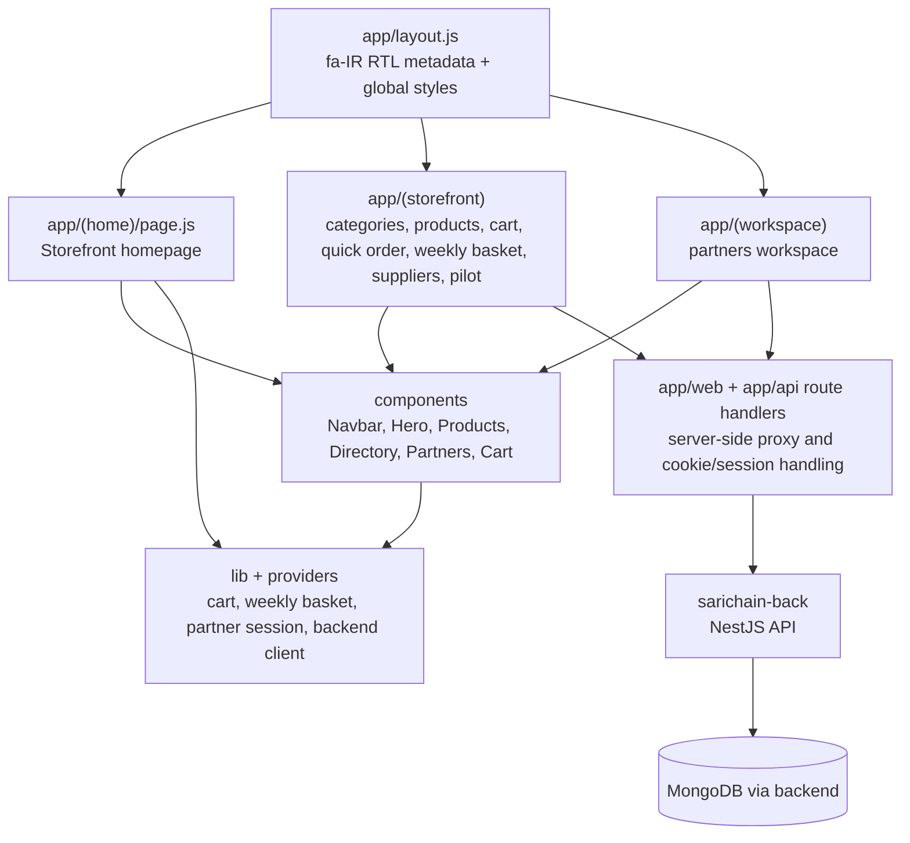

# Sarichain Website — Knowledge Graph

> Snapshot: `main` | Architecture map for future task handoffs. This covers the website and its server-side integration with the backend.

## Runtime and stack
- Next.js 16 App Router + React 19; Node.js >= 20.9.
- Server components/pages render the storefront and workspace; route handlers under `src/app/api` and `src/app/web` proxy selected operations to the backend.
- Backend base URL is server-side `BACKEND_URL`, defaulting to `http://127.0.0.1:3001`.
- Persian RTL root layout; local Peyda/Vazirmatn font assets and shared logo assets.
- `npm run dev`, `npm run build`, `npm start`.

## Knowledge graph

## Route groups and feature boundaries
- **`(home)`**: main marketplace landing page; server-loads catalog and account/cart context; renders search, weekly basket entry, categories and selected product cards.
- **`(storefront)`**: catalog browsing, product detail, cart, quick order, weekly basket, suppliers directory and pilot pages.
- **`(workspace)`**: partner login/profile/dashboard and operational sections for sellers/service providers.
- **`components/Products`**: catalog data adapter, categories/product marketplace, product detail/purchase/seller selection, units/prices and order submission.
- **`components/Partners`**: partner profile/capability workflows, producer offers, orchard/workspace records, transport and bulletin.
- **`components/modals`**: cart and weekly-basket state/presentation.
- **`components/Directory`**: supplier directory presentation.
- **`lib/partnerBackend.js`**: server-side backend fetch wrapper; `lib/accountCart.js` and weekly-basket helpers support account persistence.

## Main data flow
1. Storefront pages read public catalog from the backend through the catalog data adapter.
2. Product and variant cards enrich display with producer offers; selected `offerId` is retained through cart/order flow.
3. Guest cart state can be held in a cookie; after login the server attempts to merge it into the member account cart.
4. Partner login is proxied server-side; the access token is stored in an HttpOnly session cookie, not exposed as a browser-managed token.
5. Partner workspace reads profile/capabilities first, then fetches the requested orders, bulletin or workspace section.
6. Next route handlers validate request shape/origin/content type for supported operations and forward to backend `/web/*` APIs.

## Backend integration
- Public catalog: `GET /web/products`, `/web/categories`, `/web/brands`.
- Member account: `POST /web/login`, profile, orders, delivery options and account-upgrade endpoints.
- Workspace: `/web/workspace/{section}`, transport orders and related vehicle/profile endpoints.
- Material supplier directory: backend `/directory/material-suppliers` through the website server-side integration.
- Set `BACKEND_URL` in the Next.js server environment; do not put backend secrets or tokens in client bundles.

## Change-impact guide
- Homepage sections and composition: `src/app/(home)/page.js` and colocated `home.css`.
- Global metadata, RTL and root styling: `src/app/layout.js`, `src/App.css`.
- Storefront route composition: `src/app/(storefront)/`; product behavior: `src/components/Products/`.
- Partner portal: `src/app/(workspace)/partners/page.js` and `src/components/Partners/`.
- Cart behavior/state: `src/components/modals/`, `src/components/Products/cartData.js`, `src/lib/accountCart.js`.
- Backend URL, cookie session and forwarding: `src/lib/partnerBackend.js`, `src/app/web/`, `src/app/api/`.
- Contract changes must be checked against `lllidon/sarichain-back`; admin workflows are in `lllidon/sarichain-panel`.

## Cross-project links
- Admin panel: https://github.com/lllidon/sarichain-panel
- Backend: https://github.com/lllidon/sarichain-back
