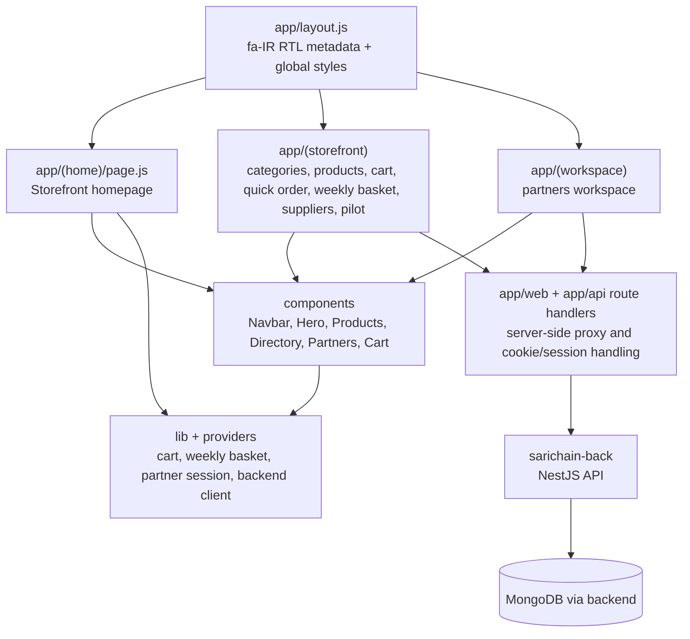

# Sarichain Website — Knowledge Graph

> Snapshot: `main` | Architecture map for future task handoffs. This covers the website and its server-side integration with the backend.

## Runtime and stack
- Next.js 16 App Router + React 19; Node.js >= 20.9.
- Server components/pages render the storefront and workspace; route handlers under `src/app/api` and `src/app/web` proxy selected operations to the backend.
- Backend base URL is server-side `BACKEND_URL`, defaulting to `http://127.0.0.1:3001`.
- Persian RTL root layout; local Peyda/Vazirmatn font assets and shared logo assets.
- `npm run dev`, `npm run build`, `npm start`.

## Knowledge graph

## Route groups and feature boundaries
- **`(home)`**: main marketplace landing page; server-loads catalog and account/cart context; renders search, weekly basket entry, categories and selected product cards.
- **`(storefront)`**: catalog browsing, product detail, cart, quick order, weekly basket, suppliers directory and pilot pages.
- **`(workspace)`**: partner login/profile/dashboard and operational sections for sellers/service providers.
- **`components/Products`**: catalog data adapter, categories/product marketplace, product detail/purchase/seller selection, units/prices and order submission.
- **`components/Partners`**: partner profile/capability workflows, producer offers, orchard/workspace records, transport and bulletin.
- **`components/modals`**: cart and weekly-basket state/presentation.
- **`components/Directory`**: supplier directory presentation.
- **`lib/partnerBackend.js`**: server-side backend fetch wrapper; `lib/accountCart.js` and weekly-basket helpers support account persistence.

## Main data flow
1. Storefront pages read public catalog from the backend through the catalog data adapter.
2. Product and variant cards enrich display with producer offers; selected `offerId` is retained through cart/order flow.
3. Guest cart state can be held in a cookie; after login the server attempts to merge it into the member account cart.
4. Partner login is proxied server-side; the access token is stored in an HttpOnly session cookie, not exposed as a browser-managed token.
5. Partner workspace reads profile/capabilities first, then fetches the requested orders, bulletin or workspace section.
6. Next route handlers validate request shape/origin/content type for supported operations and forward to backend `/web/*` APIs.

## Backend integration
- Public catalog: `GET /web/products`, `/web/categories`, `/web/brands`.
- Member account: `POST /web/login`, profile, orders, delivery options and account-upgrade endpoints.
- Workspace: `/web/workspace/{section}`, transport orders and related vehicle/profile endpoints.
- Material supplier directory: backend `/directory/material-suppliers` through the website server-side integration.
- Set `BACKEND_URL` in the Next.js server environment; do not put backend secrets or tokens in client bundles.

## Producer category permissions and offer entry

- `src/components/Partners/AccountUpgradeCenter.js` exposes `ProducerCategoryEditor` to an already-approved producer. It submits the complete desired category-ID set; at least one category must remain selected. The current permissions remain active while the request is pending.
- The editor sends `POST /web/account-upgrades/producer-categories` through the website's `api()` helper.
- `src/app/web/account-upgrades/producer-categories/route.js` is the dedicated Next.js server route for that nested path. It requires JSON, rejects cross-site requests, reads the HttpOnly partner session cookie, and forwards the request to the backend endpoint using `partnerBackend`. Do not assume the generic one-segment `/web/[resource]` handler covers this nested route.
- `src/app/(workspace)/partners/page.js` derives the producer's allowed category IDs from `profile.allowedProductCategoryIds`, then passes only matching categories and products to `PartnerDashboard`. Brand choices are further limited to brands referenced by those products.
- `src/components/Partners/PartnerDashboard.js` passes those scoped arrays to `ProductOfferForm`; the offer form must not be given the full catalog for producer selection.
- Related backend and admin-panel behavior is documented in their respective `docs/KNOWLEDGE_GRAPH.md` files. Contract chain: producer editor → Next.js proxy → backend request/review → member's `allowedProductCategoryIds` → scoped offer form.
- Relevant changes: website PR #6 (category-change UI), PR #8 (nested proxy route), and the producer catalog visibility change on `main`. These changes were merged; deploy the web app to make them live.

## Backend-hosted catalog images

- `src/components/Products/catalog-data.js` reads product and category records from the backend catalog API. Database image fields may contain relative paths such as `/uploads/products/SC-1001.webp` and `/uploads/category/demo-fresh-produce.webp`.
- The `resolveBackendImage` helper resolves only `/uploads/` paths against `process.env.BACKEND_URL`, preserving existing absolute URLs, data/blob URLs, and frontend-local assets such as `/img/catalog/field.webp`.
- Product image resolution covers every `gallery` item, the selected product image, and full-size image. Category image resolution covers `thumbnailUrl` and `imageUrl`.
- The backend must physically contain the downloaded files under its `public/uploads/products` and `public/uploads/category` directories and serve them at `/uploads/`. Running the downloader on a developer workstation writes files to that workstation, not to the production server; run it on the server (or transfer the generated directory) for production availability.
- Production web deployment must have `BACKEND_URL=https://admin.dehaat.ir` so relative upload paths resolve to the backend host.

## Storefront catalog pagination

- `src/components/Products/CategoriesPage.js` owns the public product listing, filters, sorting and client-side pagination (12 products per page).
- `paginationItems(current, total)` produces the same compact numbered-page window as the admin panel: show all pages when there are at most 5; otherwise show at most 5 numeric page buttons (including first/last), nearby pages and ellipses.
- The pagination nav includes accessible previous/next controls, numbered buttons with `aria-current="page"`, Persian-formatted page labels and focus/scroll back to the results heading after page changes.
- `src/components/Products/CategoriesPage.css` styles the green active state, page buttons, ellipses, hover/disabled states and responsive wrapping for mobile.
- Search, category, brand, unit, price, form, detail and sort filters reset the page to 1. Keep the pagination window synchronized with the derived filtered `results` count.

## Header cart preview and account quick access

- `src/components/NavQuickActions.js` is the shared client-side cart/account action UI used by both the storefront navbar and the homepage header.
- Cart preview opens on hover and keyboard focus. It reads the active guest/account cart through `useCatalogCart`, resolves names and prices with `displayCart`, and receives exact images through `readProductImageMap`; missing images use a neutral placeholder rather than an unrelated field photo. It shows up to five line items, quantities and priced subtotal, and links to `/cart`.
- Account quick menu opens on click and closes on outside pointer interaction. It shows the signed-in member name, current Karsha balance, and existing destinations: dashboard, orders, weekly basket, wallet and profile, plus products when `profile.capabilities.sell` is true and transport bulletin when `profile.capabilities.drive` is true. Sign-out uses the existing `leaveWorkspace` server action.
- `src/lib/accountMenu.js` fetches the authenticated member profile from `/web/profile` and wallet summary from `/web/karsha`, then passes only the member name, relevant capabilities, and balance to client navigation.
- `src/app/(storefront)/layout.js` provides the account summary to `Navbar` and `BottomNavbar`. The mobile bottom navigation opens an account quick-access sheet with the same destinations and Karsha balance.
- The homepage header in `src/app/(home)/page.js` uses `NavQuickActions` within `CatalogProvider` and `AccountCartProvider`; it loads the current account cart/profile/wallet in parallel with homepage data.
- Homepage and storefront layouts call `readProductImageMap` for the exact cart and weekly-basket product IDs. The helper uses the backend's public `GET /web/products/by-ids?ids=...` endpoint, which resolves master and variant IDs to their actual product images. The weekly basket card shows up to three selected products with approximately 60% overlap, an accurate `+N` count for the remaining basket items, and a neutral placeholder only when a product has no image; an empty basket no longer displays unrelated sample photos. Its CTA opens `/weekly-basket`.
- `src/components/HomeHeroCarousel.js` intentionally contains no search form; the primary slide CTA remains. Header-level search is unchanged.

## Change-impact guide
- Homepage sections and composition: `src/app/(home)/page.js` and colocated `home.css`.
- Global metadata, RTL and root styling: `src/app/layout.js`, `src/App.css`.
- Storefront route composition: `src/app/(storefront)/`; product behavior: `src/components/Products/`.
- Partner portal: `src/app/(workspace)/partners/page.js` and `src/components/Partners/`.
- Cart behavior/state: `src/components/modals/`, `src/components/Products/cartData.js`, `src/lib/accountCart.js`.
- Backend URL, cookie session and forwarding: `src/lib/partnerBackend.js`, `src/app/web/`, `src/app/api/`.
- Contract changes must be checked against `lllidon/sarichain-back`; admin workflows are in `lllidon/sarichain-panel`.

## Cross-project links
- Admin panel: https://github.com/lllidon/sarichain-panel
- Backend: https://github.com/lllidon/sarichain-back
